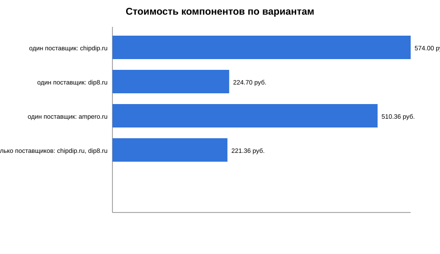

# Сравнение вариантов закупки
Дата формирования: 2026-11-22T17:24:48+03:00

## График

## Результаты

Методика: стоимость компонентов = сумма (требуемое количество * цена в [data.csv](./data.csv)).
Доставка и сроки не подставляются. Значение `н/д` исключает вариант из соответствующего выбора.

- Минимальная стоимость компонентов (без подтвержденной доставки): 221.36 руб.; несколько поставщиков: chipdip.ru, dip8.ru.
- Минимальная общая стоимость с доставкой: невозможно определить — доставка `н/д`.
- Минимальный срок поставки: невозможно определить — срок поставки `н/д`.
- Минимальная стоимость при сроке не более 10 рабочих дней: невозможно определить — сроки `н/д`.

## Сравнение одного и нескольких поставщиков

Для полного перечня в [data.csv](./data.csv) нет полного набора цен у одного поставщика; вариант одного поставщика не сформирован.
Раздельная закупка по минимальным ценам компонентов сформирована только как материальная оценка, без доставки и сроков.

## Mouser и DigiKey

API-запрос не выполнялся: ключи API и учетные данные в проекте отсутствуют. Цены этих поставщиков не выдумывались.

Подробные строки вариантов: [purchase_options.csv](./purchase_options.csv).
